<h1 align="center">publish-repo</h1>

<p align="center">
  
</p>

<p align="center">
  Publish release commits and Git tags.
</p>

<p align="center">
  <a href="https://github.com/tanaabased/actions/actions/workflows/pr-publish-repo.yml"></a>
</p>

Prepares release files, creates a verified commit on the target branch, and
forces the exact release tag plus any requested moving tags to that commit. It
is the Git publication peer of package and archive publishers; it does not
create a GitHub Release.

Supported runner: Linux (`ubuntu-24.04`).

## Usage

Supply a `sync-token` authorized to commit to the target branch and push tags.
GitHub attributes the verified commit to the token’s account. Use the bot’s token
when repository rules require publication as `tanaabot`.

```yaml
jobs:
  publish-repo:
    runs-on: ubuntu-24.04
    permissions:
      contents: read
    steps:
      - uses: actions/checkout@v7
        with:
          ref: ${{ github.sha }}
          fetch-depth: 0
      - uses: tanaabased/actions/publish-repo@v1
        with:
          commands: bun run build
          sync-tags: v1
          sync-token: ${{ secrets.RELEASE_SYNC_TOKEN }}
```

Run each publisher in its own job and check out `github.sha`. This action moves
the release tag, so a peer job checking out that tag can receive a different commit.
Outside a release event, supply `version`, `release-date`, and `release-url`.

## Inputs

| Input          | Required | Default                          | Description                                                                        |
| -------------- | -------- | -------------------------------- | ---------------------------------------------------------------------------------- |
| `dry-run`      | No       | `false`                          | Prepare locally without committing, pushing, or requiring publication credentials. |
| `debug`        | No       | `auto`                           | `auto`, `true`, or `false`; `auto` enables diagnostics when `RUNNER_DEBUG=1`.      |
| `version`      | No       | Release tag                      | Semver-valid exact tag and project version.                                        |
| `release-date` | No       | Release publication timestamp    | Date or timestamp formatted as `Month D, YYYY` for the changelog.                  |
| `release-url`  | No       | Release URL                      | Link recorded in the changelog.                                                    |
| `commands`     | No       | —                                | Project-specific preparation commands.                                             |
| `root`         | No       | `${{ github.workspace }}`        | Repository root containing the release source and `package.json`.                  |
| `bun-version`  | No       | `auto`                           | [Project discovery](../setup-bun/README.md) or explicit Bun version.               |
| `sync-branch`  | No       | Release target or current branch | Branch that receives the release commit.                                           |
| `sync-tags`    | No       | —                                | Newline-separated moving tags, such as `v1`, forced to the release commit.         |
| `sync-token`   | No       | `${{ github.token }}`            | Token authorized to create the verified commit and push tags.                      |

Runtime discovery uses `root`; the resolved version is passed upstream.
The upstream preparation action has no debug input.

## Outputs

| Output             | Description                                                       |
| ------------------ | ----------------------------------------------------------------- |
| `resolved-version` | Semver-valid version resolved by the upstream preparation action. |

## Examples

See [the combined release example](../publish-npm/examples/release.yml) for npm
and repository publication in independent jobs.

## Notes

- Package and changelog updates follow the [release preparation rules](../prepare-release/README.md#notes).
- Retry from the original release commit. Each run prepares the files again and moves the requested tags to the resulting commit.
