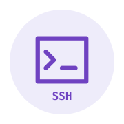

<h1 align="center">ssh-test-key</h1>

<p align="center">
  
</p>

<p align="center">
  Generate a local Ed25519 test key.
</p>

<p align="center">
  <a href="https://github.com/tanaabased/actions/actions/workflows/pr-ssh-test-key.yml"></a>
</p>

Supported runners: Linux (`ubuntu-24.04`) and macOS (`macos-26`).

## Usage

```yaml
- name: Create a temporary SSH key
  id: ssh-key
  uses: tanaabased/actions/ssh-test-key@v1
  with:
    destination: ${{ runner.temp }}/fixture/id_ed25519
    comment: fixture@example.test
```

Omit `destination` to create the pair in an isolated directory below
`RUNNER_TEMP`.

## Inputs

| Input         | Required | Default        | Description                                                                   |
| ------------- | -------- | -------------- | ----------------------------------------------------------------------------- |
| `debug`       | No       | `auto`         | `auto`, `true`, or `false`; `auto` enables diagnostics when `RUNNER_DEBUG=1`. |
| `destination` | No       | —              | Private-key destination; the public key is written at `<destination>.pub`.    |
| `comment`     | No       | `ssh-test-key` | Comment recorded in the public key.                                           |

Debug includes the public-key fingerprint and path, never private-key contents.

## Outputs

| Output             | Description                                 |
| ------------------ | ------------------------------------------- |
| `private-key-path` | Absolute path to the generated private key. |
| `public-key-path`  | Absolute path to the generated public key.  |

## Notes

- Choose an unused destination. The action refuses to overwrite either file in the pair.
- The private key is written with mode `600` and the public key with mode `644`. Remove the key pair when your job finishes using it.
